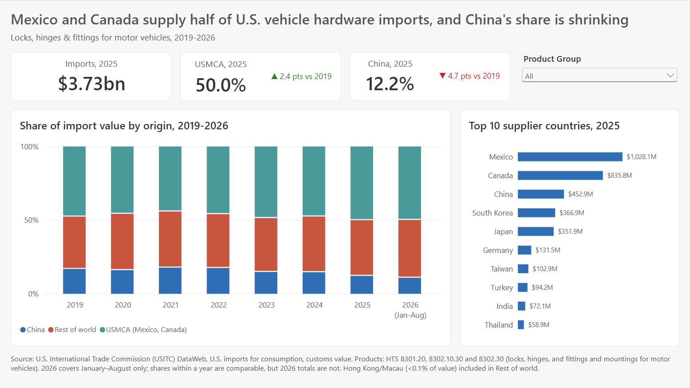
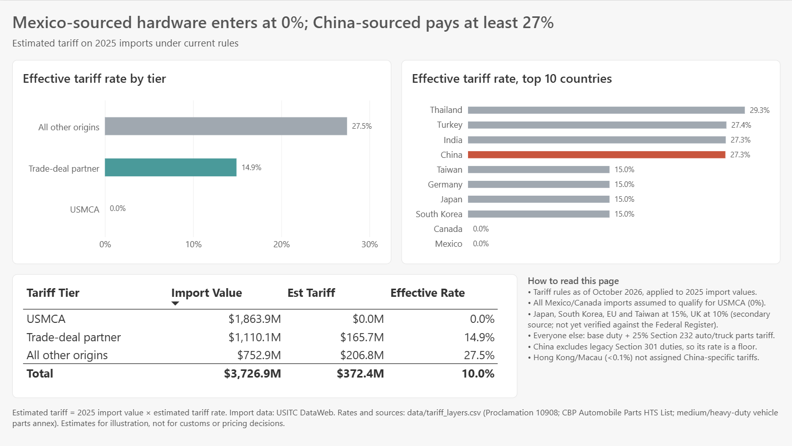
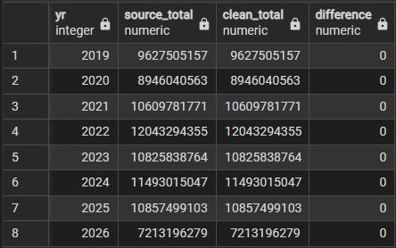

# Vehicle Hardware Imports: Tariff Exposure by Origin

Tariffs are reshuffling where vehicle hardware comes from, and what it costs to bring in. This project builds a sourced, verified tariff-rate layer on top of public U.S. trade data for motor-vehicle locks, hinges and fittings ($3.73B in 2025 imports). It's built to answer a pricing and sourcing question: **what does the same part cost to land from Mexico, versus China, versus a trade-deal partner, under current rules?**

**Tools:** PostgreSQL (SQL), Power BI · **Data:** USITC DataWeb, Harmonized Tariff Schedule (HTS), CBP and Federal Register tariff notices

## What it demonstrates

Public trade data is messy, and a tariff estimate is only as good as the data under it. Most of the work here went into making the numbers trustworthy, and proving it:

- **Reconciled to the source.** After cleaning, reshaping and joining, the trade table sums to DataWeb's own published Total row with a **$0 difference in all 8 years**. Nothing was lost or double-counted.
- **Every data decision documented.** Fourteen data issues (non-data rows, blanks loaded as text, mixed rate formats, HTS code splits, a join that worked on neither key alone) are logged with what was found, why it matters, and what was done, in [cleaning_log.md](cleaning_log.md).
- **Checks after every build.** One join draft returned the right row count but would have left 3,917 rows without a tariff rate. An orphan check caught it before anything was built on it.
- **Tariff rules from a sourced table, not assumptions.** [data/tariff_layers.csv](data/tariff_layers.csv) lists each rule with its source and whether it was verified against an official document. A tariff is applied only where it's confirmed to apply to that origin and code.
- **Dashboard reconciled to the SQL.** Power BI recalculates every number with its own measures, so the dashboard was checked against the SQL results. An early version of the share measure showed 100% for every origin because it didn't clear all the origin filters; after the fix, the dashboard's shares match the SQL exactly.

## What it shows

- **Rate is not the same as exposure.** Thailand, India and Turkey carry higher effective tariff rates than China (Thailand is highest at 29.3%), but their combined import value is smaller, so China remains the larger exposure in dollars.
- **Tariff tiers line up in reverse with market share.** USMCA-qualifying hardware from Mexico and Canada enters at 0% and supplies half the market. Trade-deal partners (Japan, South Korea, the EU and Taiwan at 15%, the UK at 10%) pay an effective 14.9%. All other origins, including China, pay an effective 27.5% on average, ranging by country from China's 27.3% to Thailand's 29.3% among the top suppliers.
- **The mix is shifting, slowly.** Mexico and Canada rose from 47.6% of imports in 2019 to 50.0% in 2025. China fell from 16.9% to 12.2%.

The tier ordering is *consistent with* buyers favoring low-tariff sources, but a single year doesn't prove it: Mexico and Canada were already near half the market in 2019. The stronger evidence is the shift over time. Details and caveats are in [findings.md](findings.md).

## How it can be used

The per-code, per-origin tariff rates built here are the foundation for **landed-cost comparisons**: the cost of the same part brought in from different origins, and how that gap changes as tariff rules change. National import data shows where the market is moving; the rate layer is what makes it usable for a pricing or sourcing decision on a specific product.

## Method

1. **Load untouched.** Both source files load into a `raw` schema as text, exactly as downloaded. Every change after that is in SQL, so it can be rerun and explained.
2. **Profile and log.** Find each data problem and record the decision in the cleaning log before fixing anything.
3. **Build clean tables.** Reshape the trade data from one column per year to one row per year, convert duty rates to numbers, and join each trade line to its rate on the 10-digit or 8-digit HTS code.
4. **Reconcile.** Tie the clean tables back to the source's control total.
5. **Apply tariff rules.** Assign each origin a tier from the sourced rules table and estimate the tariff on 2025 import values.
6. **Visualize and reconcile again.** Build the Power BI pages and check their numbers against the SQL results.

## Scope and assumptions

- **Products:** 6 HTS codes under 8301.20, 8302.10.30 and 8302.30 (locks, hinges, and fittings and mountings for motor vehicles). U.S. imports for consumption, customs value, 2019 through August 2026.
- **Tariff rules as of October 2026, applied to 2025 import values.**
- All Mexico and Canada imports are assumed to qualify for USMCA (0%).
- The 15% deal-partner rate comes from a secondary source and is labeled as an estimate.
- All other origins pay base duty plus the 25% Section 232 auto and truck parts tariff.
- Legacy Section 301 duties on China are excluded, so China's rate is a floor.
- Hong Kong and Macau (<0.1% of value) are not assigned China-specific tariffs.

These are estimates for illustration, not for customs or pricing decisions.

## Repository

| Path | What it is |
|---|---|
| `sql/` | One numbered file per step, `01_setup.sql` through `14_duty_estimate.sql`. Run in order to rebuild everything from the raw files. |
| `data/raw/` | Source files as downloaded (DataWeb export, HTS schedule) |
| `data/tariff_layers.csv` | Tariff rules with sources and verification status |
| `cleaning_log.md` | Every data issue found, the decision made, and the validation checks |
| `findings.md` | What the data says, with the query behind each finding |
| `tariff_theme.json` | Power BI theme (colors and fonts) |
| `*.pbix` | The Power BI dashboard |
| `images/` | Dashboard and validation screenshots |
| `tasks_batch1–3.md`, `sql_cheat_sheet.md` | Working notes: the build plan and SQL reference used along the way |

## Rebuild it

1. Create a PostgreSQL database `tariff_demo` with schemas `raw` and `clean`.
2. Run the files in `sql/` in numbered order. Loading the CSVs uses pgAdmin's Import tool or `\copy`.
3. Open the `.pbix` in Power BI Desktop and point the PostgreSQL connection at your server.
